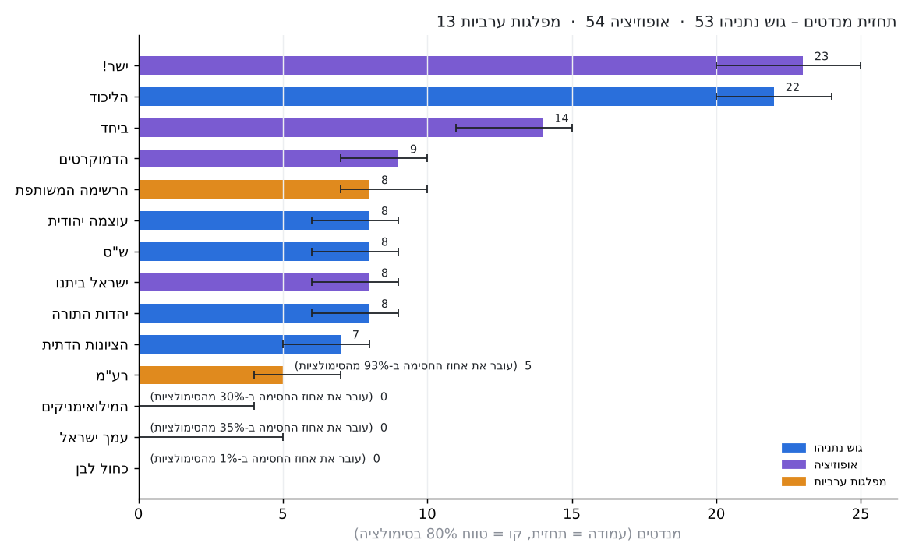
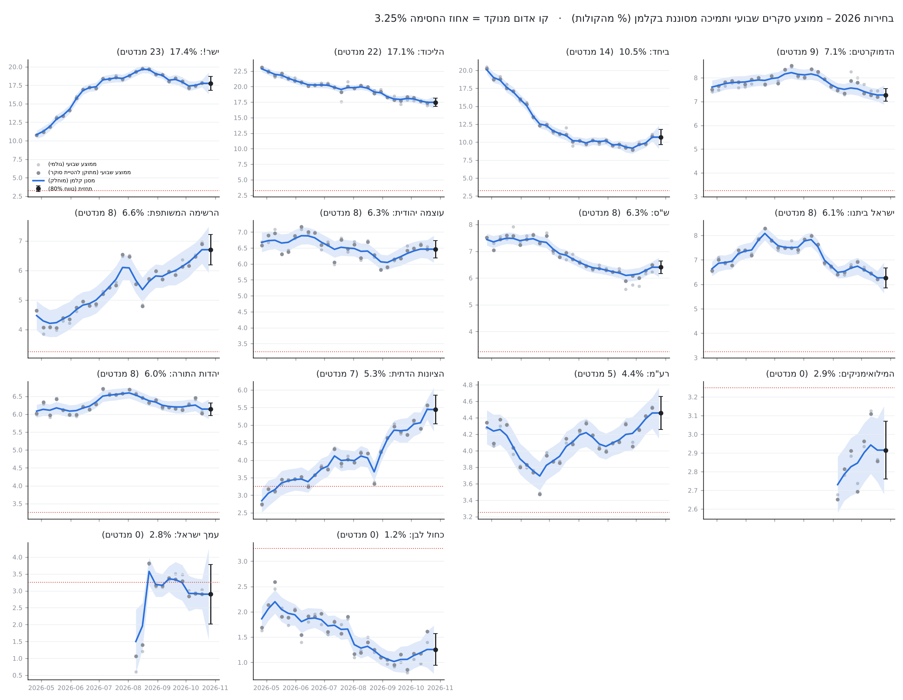

# predict_elections_2026

Forecast of the **2026 Israeli Knesset election** (27 October 2026) from published opinion polls, using weekly poll averages and a **Kalman filter per party**.



## Method

1. **Data** – 184 seat-projection polls, 26 Apr – 23 Oct 2026 (`data/israel_polls_2026.csv`).
2. **Seats → vote share.** Each poll is converted back to % of the vote: `share = seats / 120 × (100 − wasted)`, where *wasted* is the reported % of the parties below the threshold.
3. **House effects.** Each pollster's systematic lean per party is estimated, shrunk toward zero, and removed.
4. **Weekly averages** (Israeli week, Sun–Sat).
5. **Kalman filter** (local-level model) for each party:
   - state `x_t = x_{t-1} + w`, `w ~ N(0, q)`
   - observation `y_t = x_t + v`, `v ~ N(0, r / n_t)`, where `n_t` is the number of polls that week
   - `r` comes from the within-week spread of the polls; `q` is estimated by maximum likelihood; an RTS smoother is used for the historical path.
6. **Election day.** One-step-ahead forecast → 5,000 simulated elections (per-party error + a shared bloc error) → **3.25% threshold (אחוז חסימה)** → 120 seats by **D'Hondt (Bader-Ofer)**.



## Forecast

| Party | Vote % | Seats |
|---|---|---|
| ישר! (Yashar) | 17.4 | 23 |
| הליכוד (Likud) | 17.1 | 22 |
| ביחד (Together) | 10.5 | 14 |
| הדמוקרטים (Democrats) | 7.1 | 9 |
| הרשימה המשותפת (Joint List) | 6.6 | 8 |
| עוצמה יהודית (Otzma) | 6.3 | 8 |
| ש"ס (Shas) | 6.3 | 8 |
| ישראל ביתנו (Yisrael Beiteinu) | 6.1 | 8 |
| יהדות התורה (UTJ) | 6.0 | 8 |
| הציונות הדתית (Religious Zionism) | 5.3 | 7 |
| רע"מ (Ra'am) | 4.4 | 5 |
| המילואימניקים (Reservists) | 2.9 | 0 |
| עמך ישראל (Amcha Yisrael) | 2.8 | 0 |
| כחול לבן (Blue & White) | 1.2 | 0 |

**Blocs:** Netanyahu bloc 53 · opposition (Jewish parties) 54 · Arab parties 13. Neither bloc reaches 61 in more than ~3% of simulations.

## Run it

```bash
pip install -r requirements.txt
jupyter notebook predict_elections_2026.ipynb
```

Outputs (CSV tables and charts) are written to `outputs/`.

## Limitations

- House-effect centring assumes the *average* pollster is right. Channel 14 / i24 polls put the Netanyahu bloc ~5–10 seats higher.
- Surplus-vote agreements (הסכמי עודפים) are not modelled.
- Turnout, especially in the Arab sector, is not captured by the polls' seat projections.

## Data sources

- [Middle East Forum – Israel Election 2026 Poll of Polls](https://israelvote.meforum.org/polls/)
- Final polls of 23 Oct 2026: [Times of Israel](https://www.timesofisrael.com/final-polls-before-election-show-both-blocs-short-of-majority-small-parties-out-of-knesset/), [Ynet](https://www.ynetnews.com/article/s1wppltnme)
